<div align="center">



<br/>


[**⚡ Live Portfolio**](https://portofolio-shin.page.gd) &nbsp;·&nbsp; [**📚 NatuBook**](https://natubook.page.gd) &nbsp;·&nbsp; <a href="https://github.com/apa973/shin"></a> &nbsp;·&nbsp; [**✉️ Email**](mailto:Shin2345zxrx@gmail.com)




</div>

<br/>


Siswa **SMKTI Dwiguna** jurusan **PPLG** (Program Perangkat Lunak dan Gim) yang berfokus pada **Front-end Development** dan **UI/UX Design** tingkat pemula.

Saya terjun ke dunia teknologi karena tertarik pada **pengembangan game** dan membuat antarmuka yang **menarik dan rapi**. Saya mampu menyelesaikan masalah **secara mandiri maupun dalam tim**.

```json
{
  "name": "Raditya Putra Aulia",
  "alias": "Shin",
  "major": "PPLG (Program Perangkat Lunak dan Gim)",
  "focus": ["Front-end Development", "UI/UX Design"],
  "interest": "Game Development",
  "location": "Depok, Jawa Barat",
  "languages": ["Indonesia", "Japanese (basic)"],
  "works_well": ["solo", "team"]
}
```

<div align="center"></div>

<br/>


<div align="center">


</div>

| Module | Tools |
| :--- | :--- |
| 🖥️ **Front-end** | `HTML` `CSS` `Tailwind CSS` `JavaScript` |
| ⚙️ **Back-end** | `PHP` |
| 🎮 **Game** | `Ren'Py` `Python` |
| 🎨 **Design** | `Web Design` `UI/UX` |
| 🧠 **Lainnya** | `Fast Adaptation` `Deep Learning` `Microsoft Office` `Bahasa Jepang (dasar)` |

<div align="center"></div>

<br/>


<table>
<tr>
<td width="50%" valign="top">

### 🎩 Portofolio Web
`● ONLINE`

Portofolio interaktif bergaya menu game **Persona 5 Royal**: layar welcome, menu utama, panel About dan Skills.

`HTML` `Tailwind CSS` `JavaScript`

**[→ portofolio-shin.page.gd](https://portofolio-shin.page.gd)**

</td>
<td width="50%" valign="top">

### 📚 NatuBook
`● ONLINE`

Perpustakaan digital **inklusif**.

`PHP` `HTML` `Tailwind CSS` `JavaScript`

**[→ natubook.page.gd](https://natubook.page.gd)**

</td>
</tr>
<tr>
<td width="50%" valign="top">

### 🏫 ARKNIGHT-TECH SCHOOL
`◐ PROJECT`

Website profil sekolah yang **cepat dan transparan**.

`PHP` `HTML` `Tailwind CSS` `JavaScript`

</td>
<td width="50%" valign="top">

### 🎌 Game Visual Novel
`◐ PROJECT`

Game edukasi visual novel untuk **belajar bahasa Jepang dasar** secara interaktif.

`Ren'Py` `Python`

</td>
</tr>
</table>

<div align="center"></div>

<br/>


<div align="center">

[](mailto:Shin2345zxrx@gmail.com)
[](https://github.com/apa973/shin)
[](https://instagram.com/shin.a.s.k)

<br/>


</div>
